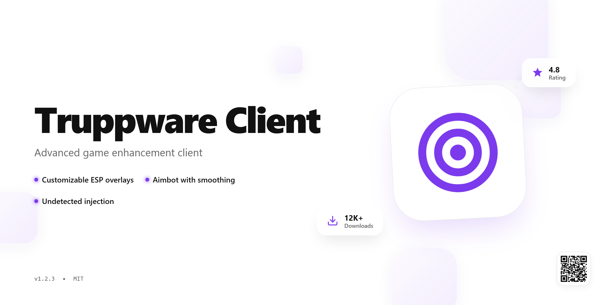

# Truppware Client — Multi-Server Minecraft Booster for Windows

### 💻 PowerShell Installer

   

---

Truppware Client is a Minecraft enhancement client built to dominate from 1.8 through 1.21.11, with confirmed performance on Hypixel and Donutsmp. It ships with MACE, CRYSTAL, SWORD, and 1.8 combat modules packed into one streamlined build. Every feature is openly accessible — no paywalls, no key systems, just download and play. Bypass routines are tuned to cut through modern anticheats with blatant confidence, so your edge stays live across every server you join.

## ✅ Requirements

- **OS:** Windows 10 / 11
- **Shell:** PowerShell 5.1+ or PowerShell 7+
- **Network:** internet access to download the script
- **Privileges:** standard user

## Features

**Truppware Client** ships with everything you need to dominate from 1.8 through 1.21.11 — no add-ons, no paywalls, no compromises.

- **Hypixel-ready, DonutsSMP-ready.** Built and battle-tested against the largest competitive servers out there. Hop in and it just works.
- **Every combat era covered.** MACE, CRYSTAL, SWORD, and classic 1.8 modules — one client for every meta, every patch, every fight.
- **Full version range.** Seamless support across Minecraft 1.8 through 1.21.11. No version juggling, no compatibility headaches.
- **Blatant bypass architecture.** Engineered to slip past every major anticheat on the market — aggressive by design, reliable under pressure.
- **Multi-server flexibility.** One install, unlimited servers. Switch targets without switching setups.
- **Accessible to everyone.** Zero cost, zero subscription, zero locked features — the full toolkit is yours from the first launch.

## How It Works

Truppware Client runs on a modular injection core that hooks directly into the Minecraft client thread at runtime. The loader maps the module registry into memory, patches the relevant render and tick loops, and leaves the base game files untouched — so every session starts clean and nothing lingers after you close the game.

**Module dispatch.** Every feature — MACE, CRYSTAL, SWORD, the 1.8 combat suite — lives as an isolated module. Toggling one fires its own event listener without dragging the rest of the stack, which keeps frame times flat even with a full loadout active. Combat modules read the current server's tick signature and adjust timing on the fly, so the same config holds across Hypixel, DonutSMP, and everything in between.

**Bypass layer.** The anticheat interaction layer sits between the modules and the network. It normalizes packet timing, rewrites rotation deltas into human-plausible ranges, and sequences actions to match legitimate input cadence. This is what keeps blatant behavior functional on servers running modern detection — the modules act, the bypass layer translates, the server sees nothing out of pattern.

**Version bridge.** A single abstraction layer covers the full 1.8 through 1.21.11 spread. Mappings are resolved at load time against whatever client version you're running, so combat math and render hooks behave identically whether you're on legacy 1.8 or the latest release. No separate builds, no version juggling.

**Config engine.** Profiles are stored locally and swapped instantly. Combat presets, module states, and bypass tuning all persist between sessions and can be rebound per server, so your Hypixel setup and your DonutSMP setup never bleed into each other.

Bottom line: inject, configure, play. The client handles the translation work — you just pick your modules and go.

## Supported Games

Truppware Client is built to run wherever the fight is. One client, every major battleground, no compromises.

- **Hypixel** — fully operational. SkyWars, BedWars, Duels, and the rest of the network run clean with the client's combat and movement modules dialed in.
- **DonutSMP** — fully operational. Built for the grind and the chaos, from daily PvP skirmishes to full-scale server warfare.
- **Multi-server coverage** — Truppware doesn't lock you to one address. It adapts across supported Minecraft multiplayer environments, so your loadout stays consistent whether you're queuing ranked or roaming survival.
- **Version range** — Minecraft 1.8 through 1.21.11. Legacy combat, modern combat, and everything in between is covered natively, including 1.8-style sword timing and modern mace and crystal mechanics.
- **Anticheat resilience** — the client is engineered for confident, blatant play, maintaining stability and functionality across the anticheat systems used by major servers.

If it's a supported server and a supported version, Truppware Client is ready. Pick your server, load your config, and go.

## Configuration

Truppware Client ships with a config system built for speed — no menu diving, no wasted clicks. Every module, bind, and profile is exposed through a clean in-game GUI and a plain-text config folder, so you can dial in your setup in seconds and carry it across every server you play.

**Profiles**
- Save and load unlimited named profiles — one for Hypixel, one for DonutSMP, one for practice servers, whatever your rotation looks like.
- Swap profiles mid-session without restarting the client.
- Each profile stores module states, keybinds, and per-server overrides in one place.

**Keybinds**
- Bind any module to any key directly from the GUI — no config file editing required.
- Supports modifier combos for tight layouts.
- Conflicts are flagged instantly so nothing gets double-bound by accident.

**Module Settings**
- Every module exposes its own sliders, toggles, and mode selectors.
- Combat modules (Mace, Crystal, Sword, 1.8) each carry independent reach, timing, and rotation controls.
- Changes apply live — tune while you play, not after a relaunch.

**Per-Server Overrides**
- Assign specific module sets to specific servers. The client detects where you are and applies the right profile automatically.
- Keep blatant settings off your main and aggressive settings on your alt servers — the client handles the switch.

**Config Files**
- All settings live in readable text files inside the client folder. Back them up, share them, or hand-edit them.
- Drop a config file in, reload from the GUI, and you're running a new setup instantly.

**Defaults That Work**
- Fresh install lands with a sane baseline — nothing enabled that you didn't ask for, everything one click away.
- Reset any module, profile, or the entire config to defaults from a single menu.

Tune it once, and Truppware stays out of your way.

## FAQ

**Is Truppware Client really accessible?**
Yes — Truppware Client is completely open to everyone. No paywalls, no premium tiers, no hidden unlocks. Every combat module, every bypass, every update ships to all users the moment it drops.

**Will it actually hold up on Hypixel and DonutSMP?**
Both are confirmed working. Truppware is built and tuned against live anticheat behavior on those servers, and the bypass layer is maintained aggressively as detection systems evolve. If a server pushes a patch, the client follows.

**Which Minecraft versions are supported?**
1.8 through 1.21.11, full spread. Combat modules — MACE, CRYSTAL, SWORD, and classic 1.8 — are calibrated per version so behavior stays consistent whether you're on legacy or current.

**Does it work on servers beyond Hypixel and DonutSMP?**
Yes. Truppware is a multi-server client by design. The bypass architecture is generalized, not hardcoded to two networks, so it carries over to most anticheat environments without extra configuration.

**Is this detectable?**
The bypass layer is built for blatant operation — meaning modules run at full strength, not sandbagged to avoid flags. Detection resistance is an active process: the client gets updated as anticheats adapt. Stay on the latest build and you stay ahead.

**Do I need to configure anything to get started?**
No. Defaults are tuned for immediate use out of the box. The Configuration section covers fine-tuning for those who want to dial in module behavior, but nothing is mandatory.

**How often does Truppware Client get updated?**
Regularly, and updates are part of the package — no separate purchase, no gated builds. When a bypass needs adjusting or a new version lands, the client reflects it.

**What if something breaks or I want to suggest a feature?**
Reach out directly through the project's community channels. Feedback drives the update cycle — bug reports and suggestions get read and acted on.

## Disclaimer

Truppware Client is built for players who want every competitive edge on the server — and it delivers that edge across Minecraft 1.8 through 1.21.11 without apology. What it does not deliver is a promise that every server will welcome it. Truppware operates in the gray zone by design: it bypasses anticheat systems openly, which means detection is always a possibility and account risk is always on you. Treat every session as expendable and every account as a test subject.

This client ships as-is. The Truppware team tunes it against major anticheats and verifies functionality on Hypixel and DonutSMP at release, but server operators patch constantly. A bypass that works today can flag tomorrow — that's the nature of the game. No warranty, express or implied, covers your account standing, your hardware, or your gameplay results. You assume full responsibility for how and where you deploy it.

Using Truppware may violate a server's rules and the terms of service of Minecraft's governing platforms. Penalties range from a quiet ban to a permanent blacklist or worse. Know the policy of every server you join before you join it. The team behind Truppware does not endorse breaking community guidelines, and mentions of specific servers in this project describe compatibility, not permission.

Truppware is distributed for personal, non-commercial entertainment. Redistribution under your own name or branding is not sanctioned. The client is provided without charge through official channels only — if you obtained it from somewhere unexpected, verify its integrity before you run it.

Use your head. Play sharp. Keep it Truppware.